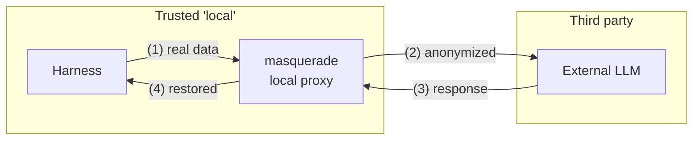

# About
## masquerade
masquerade - reversible PII anonymization proxy between your harness and the LLM.

Based for dev-ops university course.

## Goal
LLM harness agents can send sensitive data out (Anthropic, Google, OpenAI): file contents, command output, user data.

Goal of masquarade is to hide sensitive data from third parties.

## Proposed schema

## Other information
WIP

### Authors

- [@mariohuq](https://github.com/mariohuq)
- [@timofeevAS](https://github.com/timofeevAS)